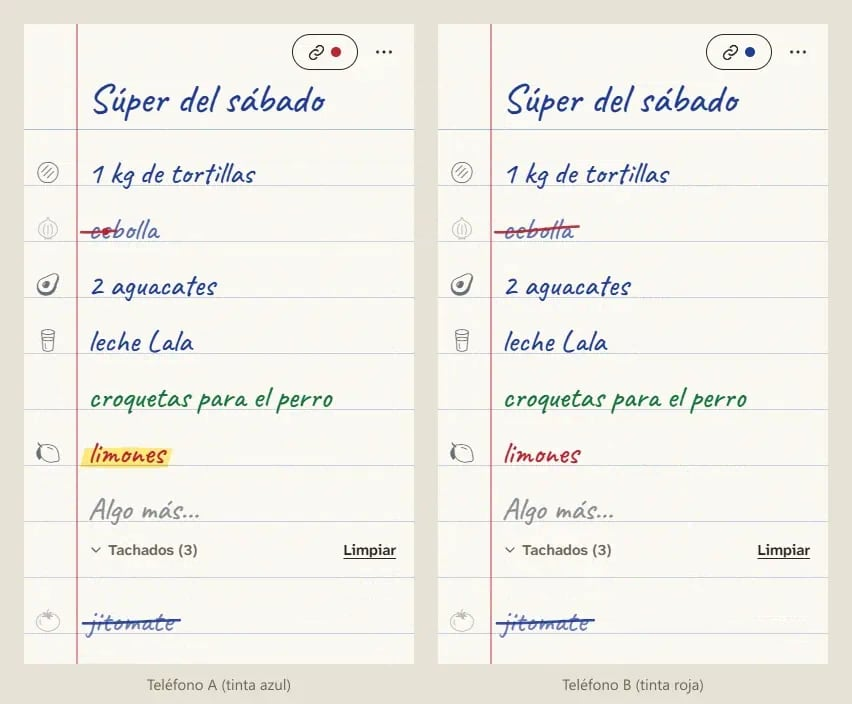

# Papelito

**La lista del súper en una hoja que dos teléfonos comparten.**
A shopping list that behaves like one piece of paper on two phones.

Write "huevos, leche" at home; it appears, in your ink, on the other phone at the supermarket. A strike there draws itself here. No accounts, nothing to install, no server of its own: the link is the key, and the list travels end-to-end encrypted.

**Use it:** https://vdm285.github.io/listolista/



*Working name: Papelito. The repository keeps its old name, ListoLista, until the owner picks one.*

## What it does

- **The first frame is the list.** It opens straight to the sheet, drawn from your phone's storage; the network only ever adds to it. Works offline; installs as an app.
- **One sheet, two phones.** Tap *Compartir*, send the link (WhatsApp, or the QR code on a computer). Each phone writes in its own ink (six to choose from); the other phone's writing and strikes arrive in about a third of a second (median 0.37 s over 21 measured edits on the live relays, 0.21–0.68 s, both phones writing at once included), through free public Nostr relays that carry encrypted, padded copies they cannot read.
- **Paper manners.** Commas, new lines and pasted WhatsApp lists become items. Tap to strike, or swipe and draw the line yourself. What you leave on the writing line stays on the paper. Everything can be undone, including what the other phone deleted, changed or renamed.
- **Mexican aisles.** *Ordenar por pasillo* groups the list in your store's walking order, from a dictionary built from PROFECO's price survey and INEGI's household-spending catalogue. Correct an aisle once; the list remembers it, on both phones.
- **Lo de siempre.** Your household's own history suggests, in pencil, what is probably running out.
- **Paper by day, chalkboard by night.** Handwriting or print, Spanish or English.

## How it works

- A static site on GitHub Pages (Vite + Lit). No backend, no analytics, no accounts, no keys.
- Each list is a state-based CRDT (`src/model/doc.js`): every field is a register stamped by a hybrid logical clock, deletions are tombstones plus a per-phone "seen" map, so any two copies merge to the same result in any order. Clocks are corrected against the web server's, so a phone whose clock is minutes or hours off loses nothing; a copy dated more than a day ahead is set aside with a notice.
- Sharing makes a 256-bit secret that lives only in the link's `#fragment` (never sent to any server). From it the phone derives an AES-GCM key, a Nostr signing key and an opaque name for the list. Every phone publishes its whole merged copy to its own slot on six relays; every phone listens to all slots and merges what arrives. Relays can drop data, never read or forge it.
- Research and decisions: `docs/research/`. Design rules: `docs/VISION.md`, `docs/EDITORIAL.md`. Data: `docs/PIPELINES.md`. State of the code: `HANDOFF.md`. For AI agents: `AGENTS.md`.

## Develop

```bash
npm install
npm run dev            # http://localhost:5177
npm test               # model, parser, matcher, crypto, import, dictionary
npm run smoke          # flows in a real browser (dev server up); `npm run smoke -- --sync` adds two phones on the real relays
npm run keys           # keyboard and screen-reader paths in a real browser (dev server up)
npm run live           # two phones through the real relays, timed, no browser
npm run shots          # screenshots at exact phone and desktop sizes → data/cache/shots/
npm run dict           # rebuild and check the aisle dictionary
```

## Credits

Typefaces Caveat, Atkinson Hyperlegible Next and Noto Emoji for the margin doodles (SIL Open Font License), Lit (BSD-3-Clause), noble-secp256k1, uqr and two helpers of Vite (MIT). Product vocabulary from «Quién es Quién en los Precios», PROFECO (CC BY 4.0), and the ENIGH 2024 spending catalogue (Fuente: INEGI); emoji names from Unicode CLDR (Unicode License v3). The grouping into aisles is ours; neither agency endorses this app. 209 everyday words that no source has (bolillo, totopos…) come from per-aisle override lines drafted by an AI and awaiting the owner's review; the app says so too. Full list in the app (Menú → Acerca de) and in `src/ui/credits.js`.

Built by Victor Mikhailov with AI (Gemini for the versions of December 2025 to January 2026; Claude for the September 2026 checkpoint and this rebuild).

## License

The code is released into the public domain (The Unlicense, `LICENSE`; a question for the owner, whose other projects use the Unlicense or MIT). Third-party fonts, libraries and data keep their own licences (above; full texts in `LICENSES/`, served at `/licenses/`).
